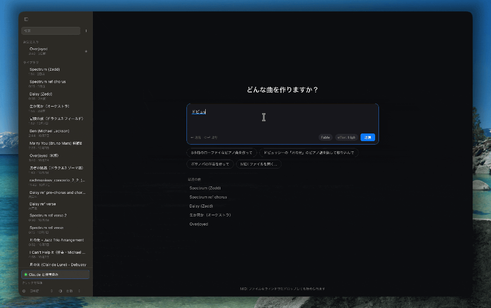

<p align="center">
  
</p>

# Otomo

**Claudeサブスクリプションで、音楽が作れる無料のOSS**  
あなたの隠れた音楽の才能を引き出しましょう。

[Web サイト](https://otomomusic.app/ja/) · [macOS 版をダウンロード](https://github.com/hibiki1213/otomo/releases/latest) · [Claude とつなぐ](#claude-とつなぐ) · [ソースからビルド](#ソースからビルド) · [English](README.md)




「ドビュッシーの月の光を作って」と頼むと、Claude が IMSLP で楽譜を探して取り込み、テンポの揺れや強弱を付けていきます。変更は保留中の編集として届き、**適用**を押すまで曲は変わりません。

## 機能

「ドビュッシーの月の光を生成して」「8 小節の lo-fi ピアノ曲を」「9〜16 小節にベースを」「ここをもっとレガートに」のように頼むと、Claude が曲を読み、Otomo のツールで小節ごと書き込みます。  
0から新しく曲を作るのも、すでにインターネット上にあるmidiや楽譜を読み込んであなたなりに改善するのも自由です。

- **編集はすべてあなたの承認制。** Claude の変更はいったん保留され、曲に直接は書き込まれません。適用した後も、ほかの編集と同じく取り消し・やり直しができます。
- **範囲を指さして頼める。** ピアノロールで範囲をドラッグしてチャットに添付すると、「ここ」「この部分」「この音域」がその範囲を指すようになります。
- **ティックではなく小節で。** Claude は小節・拍・トラック・調・強弱といった、楽譜を語るときの単位で作業します。
- **既存の曲は本物の楽譜から。** 既存の曲を頼むと、Claude は記憶で書かずに、パブリックドメインの MusicXML・MIDI・ABC・PDF 楽譜（IMSLP、Mutopia、Wikimedia Commons など）を探して取り込み、出典を伝えます。
- **扱うのは音符だけ。** Otomo が書くのは楽譜と MIDI です。音声は生成しません。作った楽譜と MIDI はあなたのものです。

## 音質と音響へのこだわり

再生エンジンは Rust で書いた独自のものです。

- **ヘッドホン向けのバイノーラル再生。** 各奏者をステージ上に配置し、実測の頭部伝達関数（SADIE II、KU100）で描画します。音が頭の外から、各パートの席の位置から聞こえます。
- **会場と座席を選べる。** レコーディングスタジオ、ライブハウス、室内楽ホール、大ホール、大聖堂。座席は前方・中央・後方から選べます。
- **本物の楽器音。** 無料のサンプル音源（Salamander Grand Piano、VS Chamber Orchestra 2 CE、FreePats、Karoryfer）をワンクリックでダウンロードでき、各トラックに合う楽器が自動で割り当てられます。手持ちの SFZ ファイルや、Mac に入っている AudioUnit 音源も使えます。それ以外は、アプリに同梱した General MIDI の SoundFont（GeneralUser GS）で鳴ります。

## MIDI・楽譜ツールとしても

- **MIDI** と **MusicXML**（.musicxml / .xml / .mxl）を開けます。ウィンドウのどこにでもドロップすればライブラリに入ります。
- 表示は 3 種類。**ピアノロール**（コード、歌詞、ピッチベンド、コントローラーのレーン付き）、浄書された**楽譜**、SysEx まで見られる**イベント一覧**。
- 小節を曲から曲へコピーし、移調して貼り付けられます。新しいトラックに入れることも、既存の音に重ねることもできます。
- **PDF** のフルスコアやパート譜（移調楽器は記譜音で）、MuseScore・Dorico・Sibelius・Finale で開ける **MusicXML** を書き出せます。
- 日本語・英語 UI、ライト／ダークテーマ。

## インストール

1. [Releases](https://github.com/hibiki1213/otomo/releases/latest) から最新の `.dmg` をダウンロードします。
2. **Otomo** をアプリケーションフォルダにドラッグして開きます。

Apple シリコン（M1 以降）の Mac と、macOS 11 以降が必要です。Intel Mac には対応していません。Otomo 単体でも再生・楽譜表示ツールとして使えます。作曲や編集には Claude をつなぎます。アプリ内チャットが使う Claude Code は macOS 13 以降が必要です。Claude Desktop は macOS 11 から使えます。

## Claude とつなぐ

Otomo には独自のアカウントやサーバーはありません。いま使っている Claude と、次のどちらか（または両方）でつながります。

|                    | 方法                                                                                       | できること                                                         |
| ------------------ | ---------------------------------------------------------------------------------------- | ------------------------------------------------------------- |
| **アプリ内チャット**       | [Claude Code](https://docs.claude.com/ja/docs/claude-code) をインストールしてログインし、Otomo で ⌘L を押す | 楽譜の横にチャットパネルが開きます。モデルと思考の深さを選べます。あなたの Claude Code のログインで動きます  |
| **Claude Desktop** | Otomo で **Claude と接続** を押し、[Claude Desktop](https://claude.ai/download) を再起動する           | Claude Desktop から Otomo のツールを使えます。編集は同じく保留中の編集として Otomo に届きます |

接続すると、Claude Desktop の MCP 設定に `otomo` の項目が 1 つだけ追加されます。設定ファイルは事前にバックアップされ、ほかのサーバーの設定には触れません。

Claude が使える MCP ツール

| 読む・聴く                                                                                              | 書く                                                                                                                                                     | 曲の設定                                                                                             |
| -------------------------------------------------------------------------------------------------- | ------------------------------------------------------------------------------------------------------------------------------------------------------ | ------------------------------------------------------------------------------------------------ |
| `list_songs` `get_song` `read_bars` `harmony` `play` `stop` `list_playback_instruments` `download` | `create_song` `write_bars` `write_score` `copy_bars` `insert_bars` `delete_bars` `add_track` `add_tracks` `set_track` `remove_track` `discard_changes` | `set_tempo` `set_time_signature` `set_key` `set_dynamics` `set_pickup` `set_playback_instrument` |

書き込みはすべて保留中の編集に入ります。Otomo で **適用** を押すまで、曲には保存されません。

## ソースからビルド

macOS と Xcode Command Line Tools、[Rust](https://rustup.rs)（stable）、Node.js と [pnpm](https://pnpm.io)、CMake（`brew install cmake`。同梱の sfizz サンプラーのビルドに使います）、[cargo-about](https://github.com/EmbarkStudios/cargo-about)（`cargo install cargo-about --features cli`。アプリに同梱するライセンス表記の収集に使います）が必要です。

```sh
git clone https://github.com/hibiki1213/otomo.git
cd otomo
pnpm install
pnpm mcp:build   # Claude がつなぐ MCP サーバーをビルド
pnpm app:dev     # 開発モードでアプリを起動
```

初めて `pnpm app:dev` か `pnpm app:build` を実行すると、アプリに同梱する General MIDI の SoundFont（GeneralUser GS、31MB）も `src-tauri/resources/` にダウンロードされます。この手順だけを行うのが `pnpm sounds` です。アプリに同梱するサードパーティのライセンス一覧は `pnpm licenses` で作ります。`app:build` は毎回、`app:dev` は一覧がないときだけ自動で実行します。

`pnpm app:build` を実行すると、リリース版の `.app` と `.dmg` が `src-tauri/target/release/bundle/` にできます。

ディレクトリ構成

| パス                                                | 内容                                                  |
| ------------------------------------------------- | --------------------------------------------------- |
| `src/`                                            | UI（React + TypeScript）：ピアノロール、楽譜、チャットパネル、ライブラリ      |
| `src-tauri/src/`                                  | アプリ本体（Rust）：ライブラリ、チャットの実行、Claude Desktop の接続設定、書き出し |
| `src-tauri/src/engine/`、`spatial/`、`instruments/` | 再生エンジン、HRTF と室内音響、SF2 / SFZ / AudioUnit の楽器         |
| `src-tauri/crates/mcp/`                           | `otomo-mcp`（Claude とやり取りする MCP サーバー）                |
| `src-tauri/crates/score/`                         | 楽譜モデル、MusicXML の読み書き                                |

## コントリビュート

バグ報告、アイデア、プルリクエストを歓迎します。日本語でも英語でもかまいません。バグは [Issues](https://github.com/hibiki1213/otomo/issues) に、質問やアイデアは [Discussions](https://github.com/hibiki1213/otomo/discussions) にどうぞ。大きな変更に取りかかる前にそこで相談してもらえると、方向性を先にすり合わせられます。開発環境の用意や確認の手順、書き方の決まりは [CONTRIBUTING.md](CONTRIBUTING.md)（英語）にまとめています。

## ライセンス

Otomo は [MIT ライセンス](LICENSE)で公開しています。名前とアイコンはライセンスの対象外です。公開するフォークには別の名前とアイコンを付けてください（[TRADEMARKS.md](TRADEMARKS.md) を参照）。「Otomo をもとに作った」と書いてもらうのは大歓迎です。

Otomo は多くのプロジェクトの成果の上に成り立っています。[sfizz](https://github.com/sfztools/sfizz)（BSD-2-Clause）、[RustySynth](https://github.com/sinshu/rustysynth)（MIT）、浄書に使う [Verovio](https://github.com/rism-digital/verovio)（LGPL-3.0）、Leipzig 音楽フォント（SIL OFL 1.1）、アプリに同梱している S. Christian Collins 氏の [GeneralUser GS](https://schristiancollins.com/generaluser.php) SoundFont（独自の寛容なライセンス）、[SADIE II](https://www.york.ac.uk/sadie-project/database.html) HRTF データベース（Apache-2.0）など。サンプル音源は別途ダウンロードされ、それぞれのライセンスに従います（アプリ内に表示されます）。詳しくは [THIRD_PARTY_NOTICES.md](THIRD_PARTY_NOTICES.md) を参照してください。すべてのライセンス文はアプリにも同梱されていて、サイドバー下部の「ライセンス」から開けます。