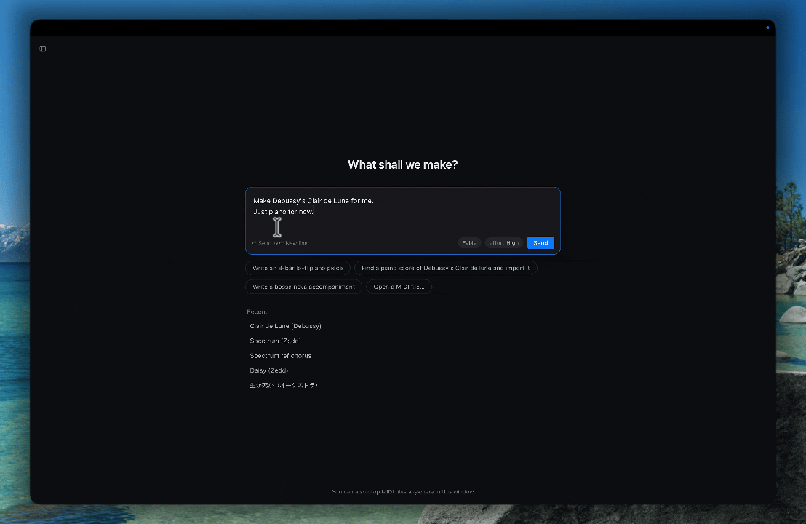

<p align="center">
  
</p>

<h1 align="center">Otomo</h1>

<p align="center">
  <b>Free, open-source music making with your Claude subscription.</b><br>
  Bring out the musical talent you didn't know you had.
</p>

<p align="center">
  <a href="https://otomomusic.app">Website</a> ·
  <a href="https://github.com/hibiki1213/otomo/releases/latest">Download for macOS</a> ·
  <a href="#connect-claude">Connect Claude</a> ·
  <a href="#build-from-source">Build from source</a> ·
  <a href="README.ja.md">日本語</a>
</p>

<p align="center">
  <a href="LICENSE"></a>
  
  
</p>

<p align="center">
  
</p>

<p align="center">
  Ask for Debussy's Clair de Lune and Claude finds a public-domain score, imports it and plays it. Ask it to play more like a person and it shapes the tempo, as a pending edit you keep only if you press <b>Apply</b>.
</p>

## Features

Ask for "Debussy's Clair de Lune", "an 8-bar lo-fi piano piece", "a bass line for bars 9–16" or "make this passage more legato", and Claude reads the song and writes whole bars through Otomo's tools.  
Start a new piece from scratch, or bring in a MIDI file or score from the web and make it your own.

- **You approve every edit.** Claude's changes are staged, never written straight into your song. Undo and redo cover them like any other edit.
- **Point at the music.** Drag a range on the piano roll and attach it to the chat: "here", "this part" and "this register" then mean exactly that range.
- **Bars, not ticks.** Claude works in bars, beats, tracks, keys and dynamics, the way a musician talks about a score.
- **Starts from real scores.** Ask for an existing piece and Claude searches for a public-domain MusicXML, MIDI, ABC or PDF score (IMSLP, Mutopia, Wikimedia Commons…), imports it, and tells you where it came from, instead of writing it from memory.
- **Notes only.** Otomo writes notation and MIDI. It does not generate audio, and the score and MIDI you make are yours.

## Sound, taken seriously

<!-- TODO(launch): link the headphone A/B clip (dry SoundFont vs. binaural + hall). -->

Otomo has its own playback engine, written in Rust:

- **Binaural for headphones.** Each player is placed on a stage and rendered through measured head-related transfer functions (SADIE II, KU100), so the orchestra sounds outside your head, from where each section sits.
- **Venues and seats.** Recording studio, live club, chamber hall, large concert hall or cathedral, heard from the front, middle or back.
- **Real instruments.** Download free sample libraries in one click (Salamander Grand Piano, VS Chamber Orchestra 2 CE, FreePats, Karoryfer) and each track gets a fitting instrument automatically. Load your own SFZ files or any AudioUnit instrument on your Mac. Everything else plays through the General MIDI SoundFont that comes with the app (GeneralUser GS).

## Also a capable MIDI and score tool

- Opens **MIDI** and **MusicXML** (.musicxml / .xml / .mxl); drop files anywhere to add them to your library.
- Three views: **piano roll** (with chords, lyrics, pitch bend and controller lanes), engraved **score**, and a full **event list** down to SysEx.
- Copy bars between songs and paste with transposition, into a new track or layered over existing notes.
- Export a **PDF** full score or parts (transposing instruments at written pitch), or **MusicXML** for MuseScore, Dorico, Sibelius and Finale.
- English and Japanese UI; light and dark themes.

## Install

1. Download the latest `.dmg` from [Releases](https://github.com/hibiki1213/otomo/releases/latest).
2. Drag **Otomo** into Applications and open it.

Requires a Mac with Apple silicon (M1 or later) and macOS 11 or later; Intel Macs aren't supported. Otomo works as a player and score viewer on its own; connect Claude to compose and edit. The in-app chat runs on Claude Code, which needs macOS 13 or later; Claude Desktop works from macOS 11.

## Connect Claude

Otomo has no account or server of its own. It talks to the Claude you already use, in either (or both) of two ways:

| | How | What you get |
|---|---|---|
| **In-app chat** | Install [Claude Code](https://docs.claude.com/en/docs/claude-code) and sign in. Press <kbd>⌘L</kbd> in Otomo. | A chat panel next to your score, with model and effort pickers. Runs on your own Claude Code login. |
| **Claude Desktop** | Click **Connect to Claude** in Otomo, then restart [Claude Desktop](https://claude.ai/download). | Otomo's tools inside Claude Desktop. Edits arrive in Otomo the same way, as pending edits. |

Connecting adds a single `otomo` entry to Claude Desktop's MCP settings, backs the file up first, and leaves your other servers alone.

<details>
<summary>The MCP tools Claude gets</summary>

| Read and listen | Write | Song settings |
|---|---|---|
| `list_songs` `get_song` `read_bars` `harmony` `play` `stop` `list_playback_instruments` `download` | `create_song` `write_bars` `write_score` `copy_bars` `insert_bars` `delete_bars` `add_track` `add_tracks` `set_track` `remove_track` `discard_changes` | `set_tempo` `set_time_signature` `set_key` `set_dynamics` `set_pickup` `set_playback_instrument` |

Every write lands in the pending-edits queue. Nothing is saved to the song until you press **Apply** in Otomo.

</details>

## Build from source

You need macOS with the Xcode Command Line Tools, [Rust](https://rustup.rs) (stable), Node.js with [pnpm](https://pnpm.io), CMake (`brew install cmake`, used to build the bundled sfizz sampler), and [cargo-about](https://github.com/EmbarkStudios/cargo-about) (`cargo install cargo-about --features cli`, which collects the license notices the app ships).

```sh
git clone https://github.com/hibiki1213/otomo.git
cd otomo
pnpm install
pnpm mcp:build   # builds the MCP server that Claude connects to
pnpm app:dev     # runs the app in development
```

The first `pnpm app:dev` or `pnpm app:build` also downloads the General MIDI SoundFont the app ships with (GeneralUser GS, 31 MB) into `src-tauri/resources/`; `pnpm sounds` does just that step. `pnpm licenses` writes the third-party license list the app ships (`app:build` runs it every time, and `app:dev` runs it when the list is missing).

`pnpm app:build` produces a release `.app` and `.dmg` under `src-tauri/target/release/bundle/`.

<details>
<summary>Where things are</summary>

| Path | What |
|---|---|
| `src/` | The UI (React + TypeScript): piano roll, score, chat panel, library |
| `src-tauri/src/` | The app (Rust): library, chat runner, Claude Desktop setup, export |
| `src-tauri/src/engine/`, `spatial/`, `instruments/` | Playback engine, HRTF and room acoustics, SF2 / SFZ / AudioUnit instruments |
| `src-tauri/crates/mcp/` | `otomo-mcp`, the MCP server Claude talks to |
| `src-tauri/crates/score/` | Score model, MusicXML reading and writing |

</details>

## Contributing

Bug reports, ideas and pull requests are welcome, in English or Japanese. Report bugs in [Issues](https://github.com/hibiki1213/otomo/issues) and bring questions and ideas to [Discussions](https://github.com/hibiki1213/otomo/discussions). Before a large change, please talk it through there first so we can agree on the direction. [CONTRIBUTING.md](CONTRIBUTING.md) covers setup, checks and conventions.

## License

Otomo is released under the [MIT License](LICENSE). The name and icon are not covered by it: a public fork needs its own name and icon (see [TRADEMARKS.md](TRADEMARKS.md)). "Built with Otomo" is welcome.

Otomo builds on the work of others, including [sfizz](https://github.com/sfztools/sfizz) (BSD-2-Clause), [RustySynth](https://github.com/sinshu/rustysynth) (MIT), [Verovio](https://github.com/rism-digital/verovio) (LGPL-3.0) for engraving, the Leipzig music font (SIL OFL 1.1), the [GeneralUser GS](https://schristiancollins.com/generaluser.php) SoundFont by S. Christian Collins (its own permissive license, bundled with the app), and the [SADIE II](https://www.york.ac.uk/sadie-project/database.html) HRTF database (Apache-2.0). Sample libraries are downloaded separately and keep their own licenses, shown in the app. [THIRD_PARTY_NOTICES.md](THIRD_PARTY_NOTICES.md) has the details. The complete list ships with the app, under **Licenses** at the foot of the sidebar.
